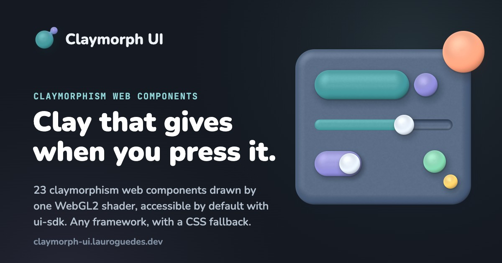

<p align="center">
  <a href="https://claymorph-ui.lauroguedes.dev"></a>
</p>

<h1 align="center">Claymorph UI</h1>

<p align="center">
  Soft clay web components drawn by one WebGL2 shader, accessible by default with <a href="https://ui-sdk.dev">ui-sdk</a>.
</p>

<p align="center">
  <a href="https://www.npmjs.com/package/claymorph-ui"></a>
  <a href="https://github.com/lauroguedes/claymorph-ui/actions/workflows/ci.yml"></a>
  
  <a href="https://github.com/lauroguedes/claymorph-ui/blob/main/LICENSE"></a>
</p>

<p align="center">
  <a href="https://claymorph-ui.lauroguedes.dev/docs/introduction"><strong>Documentation</strong></a> ·
  <a href="https://claymorph-ui.lauroguedes.dev/playground">Playground</a> ·
  <a href="https://claymorph-ui.lauroguedes.dev/showcase.html">Showcase</a> ·
  <a href="https://claymorph-ui.lauroguedes.dev/changelog">Changelog</a>
</p>

---

Claymorph UI gives ui-sdk's web components a clay body. You keep writing the ui-sdk parts you know, like `<ui-button>` or `<ui-select>`, and wrap them in a clay element. The wrapper adds the material and the motion: one shared WebGL2 shader draws every surface, with springs that swell, squash and melt parts into each other. The keyboard, focus, ARIA and forms stay in ui-sdk.

## Features

- **One shader, every surface.** A single WebGL2 context draws all the clay on a page, and stops drawing the moment nothing moves.
- **Accessible by default.** Each element wraps a ui-sdk part, so keyboard support, focus management and ARIA come built in.
- **Parts that melt together.** Lists, menus, cards and tooltips squeeze out of their trigger and stay fused to it, and `fuse` sets how far.
- **Import only what you use.** One entry per element, with types. A page with a single button ships about 22 KB gzipped, ui-sdk included.
- **Works without WebGL2.** Before the first frame, on older devices and in forced colours, the same clay is drawn with CSS.
- **Any framework.** They're web components: use them in React, Vue, Svelte, Angular, Astro or plain HTML.
- **Ready for agents.** `llms.txt`, Markdown docs and an agent skill ship with it, and every control can be operated over WebMCP.

## Install

```bash
npm install claymorph-ui @ui-sdk/web @ui-sdk/core
```

`@ui-sdk/web` and `@ui-sdk/core` are peer dependencies, so your app and Claymorph UI share one copy.

## Quick start

Load the styles once, then import the elements you use. Each import registers its element and the ui-sdk parts it wraps.

```ts
import "@ui-sdk/core/web.css"
import "claymorph-ui/clay.css"
import "claymorph-ui/button"
import "claymorph-ui/select"
```

```html
<clay-button color="teal">
  <ui-button><button>Save</button></ui-button>
</clay-button>

<clay-select attached color="teal">
  <ui-select default-value="week">
    <ui-select-label>Period</ui-select-label>
    <ui-select-trigger><button><ui-select-value></ui-select-value></button></ui-select-trigger>
    <ui-select-content>
      <ui-select-item value="day">Today</ui-select-item>
      <ui-select-item value="week">This week</ui-select-item>
    </ui-select-content>
  </ui-select>
</clay-select>
```

To register every element at once, `import "claymorph-ui"`.

## Components

Every element is named for the one thing it does.

| Verb | Component | Element | Entry |
| --- | --- | --- | --- |
| Press | Button | `<clay-button>` | `claymorph-ui/button` |
| Roll | Action button | `<clay-action-button>` | `claymorph-ui/action-button` |
| Latch | Toggle | `<clay-toggle>` | `claymorph-ui/toggle` |
| Fuse | Button group | `<clay-button-group>` | `claymorph-ui/button-group` |
| Drag | Slide to confirm | `<clay-slide-confirm>` | `claymorph-ui/slide-confirm` |
| Type | Input | `<clay-input>` | `claymorph-ui/input` |
| Slide | Segmented control | `<clay-segmented>` | `claymorph-ui/segmented` |
| Flip | Switch | `<clay-switch>` | `claymorph-ui/switch` |
| Tick | Checkbox | `<clay-checkbox>` | `claymorph-ui/checkbox` |
| Pick | Radio group | `<clay-radio>` | `claymorph-ui/radio` |
| Stretch | Slider | `<clay-slider>` | `claymorph-ui/slider` |
| Pour | Select | `<clay-select>` | `claymorph-ui/select` |
| Shift | Tabs | `<clay-tabs>` | `claymorph-ui/tabs` |
| Spill | Menu | `<clay-menu>` | `claymorph-ui/menu` |
| Unfold | Popover | `<clay-popover>` | `claymorph-ui/popover` |
| Lift | Dialog | `<clay-dialog>` | `claymorph-ui/dialog` |
| Pop | Tooltip | `<clay-tooltip>` | `claymorph-ui/tooltip` |
| Drop | Toast | `<clay-toast-region>` | `claymorph-ui/toast` |
| Hold | Card | `<clay-card>` | `claymorph-ui/card` |
| Stamp | Badge | `<clay-badge>` | `claymorph-ui/badge` |
| Frame | Avatar | `<clay-avatar>` | `claymorph-ui/avatar` |
| Fill | Progress | `<clay-progress>` | `claymorph-ui/progress` |
| Gauge | Meter | `<clay-meter>` | `claymorph-ui/meter` |

## Theming

Colour any element with the `color` attribute, a preset (`teal`, `lilac`, `sky`, `peach`, `mint`, `butter`, `rose`, `slate`, `ink`) or any CSS colour, or with the `--clay-*` custom properties. Light and dark follow `prefers-color-scheme`, or `data-theme` on `<html>`. The material itself, light, sheen, grain and shadows, lives in one `CLAY` object; tune it live in the [playground](https://claymorph-ui.lauroguedes.dev/playground).

```ts
import { CLAY, getClayEngine } from "claymorph-ui"

Object.assign(CLAY, { pillow: 0.7, grain: 0.08 })
getClayEngine()?.invalidateAll()
```

## Browser support

Any browser with WebGL2, the Popover API and CSS nesting draws the clay: current Chrome, Edge, Firefox and Safari. Without WebGL2, the CSS fallback keeps every element usable and styled.

## Links

- [Documentation](https://claymorph-ui.lauroguedes.dev/docs/introduction)
- [Source on GitHub](https://github.com/lauroguedes/claymorph-ui)
- [Changelog](https://claymorph-ui.lauroguedes.dev/changelog)
- [Issues](https://github.com/lauroguedes/claymorph-ui/issues)

## License

[MIT](https://github.com/lauroguedes/claymorph-ui/blob/main/LICENSE) © Lauro Guedes
